# Schema generation across the repository

Schema exporters, converters, language bindings, and runtime adapters use the pipelines below.
Component owners choose serialization modes, dialects, and provider-specific restrictions.
The [TypeScript macro guide](../js/SCHEMA_CODEGEN.md) documents the file-input APIs; the
[conversion spike](../x/schema_codegen/) exercises representative paths with small source models.

## Inputs, outputs, and owners

The inventory covers schema and typed-binding generation, including runtime schema adapters.
Database migrations, ordinary serialization, UI rendering, and bundling are outside this scope.

| Source and owner                                                                                                                                                                                                                                                                                                               | Export/intermediate                                                                                         | Conversion and output                                                                                                                                                                                                                                            | Consumer                                                                                            |
| ------------------------------------------------------------------------------------------------------------------------------------------------------------------------------------------------------------------------------------------------------------------------------------------------------------------------------ | ----------------------------------------------------------------------------------------------------------- | ---------------------------------------------------------------------------------------------------------------------------------------------------------------------------------------------------------------------------------------------------------------- | --------------------------------------------------------------------------------------------------- |
| FastAPI/Pydantic: [Agentplane](../../agentplane/app/export_schema.py), [Props](../../props/backend/export_schema.py), [Haku](../../haku/console/export_schema.py), [AIQuota](../../aiquota/export_schema.py), [Spend](../../finance/plaid/spend/export_schema.py), [session export](../claude/session_export/export_schema.py) | Owner-exported OpenAPI JSON                                                                                 | [`openapi_js_library`](../js/openapi_js_library.bzl), `openapi-typescript` → named `js_library` with `.d.ts` operation maps and named models                                                                                                                     | Frontend types; Agentplane, Props, and Haku also use `openapi-fetch`                                |
| FastAPI/Pydantic: [Augur](../../finance/augur/api/export_schema.py), [Study Casino](../../study_casino/export_schema.py)                                                                                                                                                                                                       | Owner-exported OpenAPI JSON, including CSV request or WebSocket frame models                                | [`openapi_zod_ts_library`](../js/openapi_zod_ts_library.bzl), Hey API Zod plugin → `.ts` → compiled `.js` and `.d.ts`                                                                                                                                            | Typed request/response validation; JavaScript fetch/WebSocket validation                            |
| [Pinned Grocy OpenAPI](../../grocy_mcp/BUILD.bazel), [request-scoped adapter](../../mcp_infra/request_scoped_openapi.py)                                                                                                                                                                                                       | Upstream OpenAPI 3.1 JSON → [Grocy-owned repairs](../../grocy_mcp/fix_openapi_spec.py)                      | FastMCP `OpenAPIProvider` → advertised tool input/output JSON Schema and executable HTTP tools                                                                                                                                                                   | [Grocy MCP](../../grocy_mcp/server.py); Grocy deliberately drops unreliable upstream output schemas |
| [SSH FastMCP tool signatures](../../ssh_mcp_server/export_frontend_schema.py)                                                                                                                                                                                                                                                  | Advertised argument/result JSON Schemas                                                                     | Producer-owned [`json_schema_js_library`](../../ssh_mcp_server/BUILD.bazel) → original JSON and generated `.d.ts`; [TS adapter](../../agentplane/app/frontend/actions/schemas/ssh/exec.ts) calls `z.fromJSONSchema`                                              | Agentplane SSH action renderers                                                                     |
| [Airlock models](../../airlock/export_schema.py), [Haku ToolCallRecord](../../haku/console/export_tool_call_schema.py)                                                                                                                                                                                                         | Pydantic serialization-mode JSON Schema                                                                     | [`json_schema_js_library`](../js/json_schema_js_library.bzl), `json-schema-to-typescript` → original JSON and model `.d.ts`                                                                                                                                      | Frontend wire and renderer types                                                                    |
| [Haku MCP tool catalog](../../haku/console/mcp/export_tool_schemas.py)                                                                                                                                                                                                                                                         | Draft 2020-12 JSON Schema catalogs for arguments and structured results                                     | [Producer-owned libraries](../../haku/console/mcp/BUILD.bazel) expose original JSON and `.d.ts`; [argument](../../haku/console/frontend/mcp_tool_schema.ts) and [result](../../haku/console/frontend/mcp_tool_result_schema.ts) adapters call `z.fromJSONSchema` | Typed previews and runtime validators from advertised FastMCP contracts                             |
| [Agentplane protobuf definitions](../../agentplane/proto/BUILD.bazel), [Action Service](../../agentplane/action_service/BUILD.bazel), [MCP edge](../../agentplane/mcp_edge/BUILD.bazel)                                                                                                                                        | `.proto` import graph and `ProtoInfo` descriptors                                                           | `protoc` plugins → Protobuf-ES JS/declarations, Go bindings, Python bindings/stubs                                                                                                                                                                               | Native messages, service definitions, protobuf binary and ProtoJSON codecs                          |
| [Native gRPC services](../../agentplane/action_service/BUILD.bazel), [runner gateway](../../agentplane/runner_gateway/BUILD.bazel)                                                                                                                                                                                             | Same annotated proto graph                                                                                  | `go_grpc_v2`, [`grpc_gateway`](../go/BUILD.bazel), [`py_grpc_service_library`](../python/grpc.bzl) → Go clients/servers and HTTP gateway; Python service modules and mypy stubs                                                                                  | Native RPC and HTTP service implementations                                                         |
| [Debundle CP-SAT](../js/debundle/BUILD.bazel)                                                                                                                                                                                                                                                                                  | Pinned OR-Tools `.proto` files                                                                              | `rust_prost_library` → Rust message bindings                                                                                                                                                                                                                     | Rust solver model and C API interoperability; no schema normalization stage                         |
| Protobuf services with `google.api.http` annotations                                                                                                                                                                                                                                                                           | Same proto graph                                                                                            | [`proto_openapi`](../go/proto_openapi.bzl), `protoc-gen-openapiv2` → Swagger/OpenAPI 2 JSON                                                                                                                                                                      | Published Action Service, notification, and egress API documentation                                |
| [Extracted Claude hook Zod modules](../claude/claude_api/hooks/schemas/2.1.105/export_json_schema.mjs)                                                                                                                                                                                                                         | Executable Zod schema                                                                                       | `z.toJSONSchema` → Draft 2020-12 JSON Schema                                                                                                                                                                                                                     | Pydantic/Zod structural-equivalence tests; this is schema publication, not TS generation            |
| [Pinned Codex protocol exporter](../../agentplane/runner/codex/protocol/BUILD.bazel)                                                                                                                                                                                                                                           | JSON Schema documents emitted by the CLI                                                                    | [Quicktype](../../agentplane/runner/codex/protocol/generate.mjs) → Go models                                                                                                                                                                                     | Runner JSON-RPC protocol implementation                                                             |
| Agentplane Go Kubernetes API types and kubebuilder markers                                                                                                                                                                                                                                                                     | Go package graph                                                                                            | [`controller-gen`](../go/controller_gen.bzl) → DeepCopy Go and CRD YAML; [`kubernetes_clients`](../go/kubernetes_clients.bzl) → Go clients, apply configurations, listers, and informers                                                                         | Controllers and the [published CRD manifests](../../agentplane/crds/generate.py)                    |
| Agentplane CRDs and pinned upstream CRDs                                                                                                                                                                                                                                                                                       | CRD YAML, sometimes extracted from bundles or Go-embedded schemas by [`extract_crd`](../k8s/extract_crd.py) | [`cdk8s_import`](../js/cdk8s_import.bzl) → Python/jsii construct packages                                                                                                                                                                                        | Typed cluster configuration and manifest synthesis                                                  |
| [Google Discovery adapter](../../x/google_mcp_server/google_discovery.py)                                                                                                                                                                                                                                                      | Google Discovery JSON plus selected method descriptions                                                     | Runtime adapter → JSON Schema and FastMCP tool definitions                                                                                                                                                                                                       | Google MCP tools; no generated source file                                                          |
| [OpenAI-compatible Pydantic exporter](../../openai_utils/json_schema.py), [Gmail adapter](../../gmail_archiver/event_classifier.py), [Ollama consumer](../../x/eob_matching/extract_pdfs.py)                                                                                                                                   | Python models                                                                                               | Runtime export → provider-compatible JSON Schema; Ollama receives ordinary Pydantic JSON Schema                                                                                                                                                                  | Structured-output requests; provider restrictions are part of this boundary                         |
| [Loom answer schemas](../../loom/gym/baseline_llm.py), [Props tool definitions](../../props/agents/af/tools.py)                                                                                                                                                                                                                | Pydantic models → JSON Schema; Loom inlines local references                                                | Component-owned adapters → Inspect/Anthropic tool input schemas                                                                                                                                                                                                  | Runtime tool advertisement, retaining provider-specific limitations                                 |
| [Operator-authored argument policies](../../agentplane/action_service/policies/argument_schema.py)                                                                                                                                                                                                                             | JSON Schema supplied as policy data                                                                         | Python checks the declared schema dialect; [Go policy evaluation](../../agentplane/action_service/policies/argument_schema.go) compiles and validates with `santhosh-tekuri/jsonschema/v6`                                                                       | Action argument authorization; no language-model generation or frontend code generation             |
| [Augur rollout vocabulary](../../finance/augur/frontend/export_rollout_event_vocabulary.py)                                                                                                                                                                                                                                    | Backend ordering plus Pydantic discriminator variants                                                       | Component-owned exporter → TS literal tuple and union                                                                                                                                                                                                            | Frontend ordering and exhaustive vocabulary types                                                   |

## Whole-repository pipelines

Blue boxes are producers, gray boxes are intermediate/output formats, amber boxes name
converters, and green boxes are consumers or checks. B means build/export time; R means runtime.
R outputs are in-memory schemas or objects unless labeled as files. Reused format boxes represent
separate owner documents unless labeled as a shared artifact. Generator-internal ASTs and ordinary
payload serialization are outside this map; spike-only paths appear in the proof matrix below.

HTTP owners export OpenAPI artifacts; model/tool owners export standalone JSON Schema, including
SSH. OpenAPI 3, standalone JSON Schema, protobuf descriptors, Swagger 2, Discovery, and Kubernetes
structural schemas keep their own converters and consumer semantics.

The OpenAPI and JSON Schema declaration macros expose a `js_library` named by the macro call and keep
the raw `.d.ts` addressable by its output label, defaulting to `<name>.d.ts`; `out` selects another
module path when a consumer needs one. A JSON Schema macro target publishes the original schema,
declared local-reference files, and generated declarations through `JsInfo` at their owner paths.
SSH and Haku place these targets beside their schema exporters, and frontend adapters import the
producer-owned JSON modules and generated types directly.
`openapi_zod_ts_library` returns a compiled `ts_library`; the macro call supplies the shared
tsconfig and runtime dependencies, while its raw `.ts` output remains addressable by file label.

```mermaid
flowchart LR
    python_models["Python / Pydantic models<br/>owned by each component"]:::producer
    fastmcp_signatures["FastMCP tool signatures<br/>SSH and Haku owners"]:::producer
  subgraph frontend["HTTP, model and tool schemas: generation and frontend consumption"]
    http_export["B: owner export target<br/>export_schema.py / app.openapi<br/>and owner CSV or WebSocket additions"]:::converter
    http_json["Declared OpenAPI 3 JSON<br/>one shared artifact per HTTP owner"]:::artifact
    api_typegen["B: openapi_js_library(name, schema, out=None)<br/>openapi-typescript + root-type flags"]:::converter
    api_types["API .d.ts<br/>paths, operations, components<br/>named model exports; raw name.d.ts by default"]:::artifact
    api_types_library["Named js_library from the macro<br/>JsInfo.transitive_types"]:::artifact
    zod_gen["B: openapi_zod_ts_library macro<br/>Hey API Zod 4 plugin"]:::converter
    python_models --> http_export
    http_export --> http_json
    http_json --> api_typegen
    api_typegen --> api_types
    api_types --> api_types_library
    http_json --> zod_gen
    model_export["B: owner model export target<br/>Pydantic / TypeAdapter<br/>explicit serialization or validation mode"]:::converter
    model_json["Declared model JSON Schema<br/>mode and dialect are explicit"]:::artifact
    tool_export["B: owner tool-schema export target<br/>FastMCP reflection / catalog selection"]:::converter
    tool_json["Declared tool JSON Schemas<br/>SSH input/output; Haku catalogs<br/>arguments and structured results"]:::artifact
    json_typegen["B: json_schema_js_library(name, schema, out=None)<br/>json-schema-to-typescript"]:::converter
    python_models --> model_export
    model_export --> model_json
    fastmcp_signatures --> tool_export
    tool_export --> tool_json
    model_json --> json_typegen
    tool_json --> json_typegen
    zod_ts["Generated Zod .ts<br/>raw file label"]:::artifact
    zod_compile["B: ts_library / tsc<br/>inside macro; named target is compiled library"]:::converter
    zod_modules["Compiled Zod outputs<br/>.js + .d.ts"]:::artifact
    zod_validation["Runtime request / response validation<br/>Augur and Study Casino<br/>TS and plain-JS consumers"]:::consumer
    model_types["Generated model .d.ts<br/>raw :out file label"]:::artifact
    tool_types["Generated tool .d.ts<br/>raw :out file label"]:::artifact
    model_types_library["Named json_schema_js_library target<br/>model JSON + declarations<br/>JsInfo.transitive_types"]:::artifact
    tool_schema_library["Named json_schema_js_library target<br/>tool JSON + declarations<br/>SSH and Haku producer packages"]:::artifact
    typed_models["Frontend wire / renderer model types<br/>checked with ts_library / tsc"]:::consumer
    http_clients["Typed HTTP clients<br/>openapi-fetch and operation types"]:::consumer
    json_runtime["R: ordinary TS adapter<br/>z.fromJSONSchema"]:::converter
    runtime_zod["Runtime Zod schema objects"]:::artifact
    tool_consumers["Haku tool previews and validation<br/>SSH action rendering"]:::consumer
    zod_gen --> zod_ts
    zod_ts --> zod_compile
    zod_compile --> zod_modules
    zod_modules -->|"import / safeParse"| zod_validation
    json_typegen --> model_types
    model_types --> model_types_library
    model_json --> model_types_library
    json_typegen --> tool_types
    tool_types --> tool_schema_library
    tool_json --> tool_schema_library
    model_types_library -->|"type-only imports"| typed_models
    api_types_library -->|"paths / operations"| http_clients
    api_types_library -->|"direct named imports; no alias module"| typed_models
    tool_schema_library -->|"direct JSON + type imports"| json_runtime
    model_types_library -->|"when runtime validation is needed"| json_runtime
    json_runtime --> runtime_zod
    runtime_zod -->|"safeParse at tested boundary"| tool_consumers
  end
  subgraph native["Native protobuf"]
    proto_sources["Agentplane .proto source graph<br/>messages; HTTP-annotated services"]:::producer
    proto_export["B: proto_library"]:::converter
    proto_info["ProtoInfo imported source closure<br/>and FileDescriptorSet artifacts"]:::artifact
    proto_es["B: ts_proto_library<br/>protoc-gen-es target=js+dts"]:::converter
    proto_js["Protobuf-ES .js + .d.ts<br/>native message and service schemas"]:::artifact
    proto_go["B: go_proto_library<br/>protoc-gen-go<br/>go_grpc_v2 / protoc-gen-go-grpc<br/>grpc_gateway / protoc-gen-grpc-gateway"]:::converter
    proto_go_src["Go .go sources<br/>messages, gRPC services, HTTP gateway"]:::artifact
    proto_py["B: py_proto_library_with_mypy_stubs<br/>protoc --python_out / --pyi_out<br/>py_grpc_service_library<br/>gRPC + protoc-gen-mypy_grpc"]:::converter
    proto_py_src["Python .py + .pyi<br/>messages and gRPC services"]:::artifact
    native_apps["TS / Go / Python apps and services<br/>native protobuf bytes and ProtoJSON codecs"]:::consumer
    proto_docs["B: proto_openapi<br/>protoc-gen-openapiv2"]:::converter
    swagger["Swagger / OpenAPI 2 JSON<br/>HTTP description; not ProtoJSON parity"]:::artifact
    published_docs["Embedded / published API references<br/>Action, notification and egress APIs"]:::consumer
    ortools["Pinned OR-Tools .proto sources"]:::producer
    ortools_export["B: proto_library"]:::converter
    ortools_info["OR-Tools ProtoInfo source closure<br/>and FileDescriptorSet artifacts"]:::artifact
    prost["B: rust_prost_library<br/>protoc-gen-prost"]:::converter
    rust_src["Rust prost .rs bindings"]:::artifact
    rust_app["Rust solver and C API consumers"]:::consumer
    proto_sources --> proto_export
    proto_export --> proto_info
    proto_info --> proto_es
    proto_es --> proto_js
    proto_info --> proto_go
    proto_go --> proto_go_src
    proto_info --> proto_py
    proto_py --> proto_py_src
    proto_info --> proto_docs
    proto_docs --> swagger
    ortools --> ortools_export
    ortools_export --> ortools_info
    ortools_info --> prost
    prost --> rust_src
    proto_js -->|"js_library; TS typecheck / runtime imports"| native_apps
    proto_go_src -->|"go_library"| native_apps
    proto_py_src -->|"py_library / mypy"| native_apps
    swagger -->|"copy_file; Go embedsrcs"| published_docs
    rust_src -->|"rust_library / Clippy"| rust_app
  end
  subgraph kubernetes["Go API schemas and CRD imports"]
    go_api["Go Kubernetes API types<br/>kubebuilder markers"]:::producer
    authored_go_path["GoPath copied source closure<br/>authored doc.go and types.go"]:::artifact
    deepcopy["B: controller_deepcopy<br/>controller-gen object"]:::converter
    deepcopy_go["zz_generated.deepcopy.go"]:::artifact
    go_api_package["Go API package / GoPath closure<br/>authored types plus generated methods"]:::artifact
    clientgen["B: kubernetes_clients<br/>applyconfiguration-gen / client-gen<br/>lister-gen / informer-gen"]:::converter
    go_clients["Go client / apply / lister / informer sources"]:::artifact
    controllers["Typed Go controller consumers"]:::consumer
    crdgen["B: controller_crds<br/>controller-gen crd"]:::converter
    generated_crd["Generated structural CRD YAML"]:::artifact
    crd_publish["B: agentplane/crds/generate.py<br/>normalization and schema projection"]:::converter
    published_crd["Published / committed CRD YAML<br/>Agentplane manifests"]:::artifact
    upstream_crds["Pinned upstream CRD YAML / bundles<br/>or Go-embedded schemas"]:::producer
    crd_extract["B: extract_crd<br/>select / unwrap / wrap schema<br/>owner-specific removal policy"]:::converter
    selected_crd["Selected CRD YAML<br/>openAPIV3Schema"]:::artifact
    cdk_import["B: cdk8s_import<br/>cdk8s import / jsii"]:::converter
    cdk_package["Typed Python .py + py.typed<br/>JSII .jsii.tgz runtime package"]:::artifact
    synth["B: Python charts / cdk8s synth<br/>mypy checks construct usage"]:::converter
    manifest_yaml["Synthesized Kubernetes YAML"]:::artifact
    cluster["Typed cluster configuration<br/>Flux / Kubernetes consumers"]:::consumer
    go_api -->|"go_path mode=copy"| authored_go_path
    authored_go_path --> deepcopy
    deepcopy --> deepcopy_go
    go_api --> go_api_package
    deepcopy_go --> go_api_package
    go_api_package --> clientgen
    clientgen --> go_clients
    authored_go_path --> crdgen
    crdgen --> generated_crd
    generated_crd --> crd_publish
    crd_publish --> published_crd
    published_crd --> cdk_import
    upstream_crds --> crd_extract
    crd_extract --> selected_crd
    selected_crd --> cdk_import
    cdk_import --> cdk_package
    cdk_package --> synth
    synth --> manifest_yaml
    manifest_yaml --> cluster
    go_clients -->|"go_library"| controllers
    published_crd -->|"CRD installation"| cluster
    upstream_crds -->|"already a single importable CRD"| cdk_import
  end
  subgraph owners["Owner-specific schema publication and runtime adapters"]
    hook_zod["Extracted Claude hook Zod source"]:::producer
    zod_export["B: export_json_schema.mjs<br/>z.toJSONSchema"]:::converter
    hook_json["Draft 2020-12 JSON Schema"]:::artifact
    schema_eq["Python Pydantic / Zod<br/>structural-equivalence checks"]:::consumer
    hook_zod --> zod_export
    zod_export --> hook_json
    hook_json --> schema_eq
    codex_cli["Pinned Codex protocol CLI"]:::producer
    codex_export["B: CLI JSON Schema export"]:::converter
    codex_json["Protocol + JSON-RPC transport<br/>JSON Schema documents"]:::artifact
    codex_select["B: protocol/generate.mjs<br/>select consumed roots / transport adapter"]:::converter
    selected_json["Selected JSON Schema root graph"]:::artifact
    quicktype["B: quicktype-core"]:::converter
    quicktype_go["Generated Go model source"]:::artifact
    runner["Go runner JSON-RPC implementation<br/>model decoding is not schema validation"]:::consumer
    codex_cli --> codex_export
    codex_export --> codex_json
    codex_json --> codex_select
    codex_select --> selected_json
    selected_json --> quicktype
    quicktype --> quicktype_go
    quicktype_go -->|"go_library"| runner
    openai_export["R: openai_json_schema<br/>shared OpenAICompatibleSchema<br/>strict fields / unions / ref siblings"]:::converter
    gmail_export["R: Gmail-local<br/>OpenAICompatibleSchema"]:::converter
    provider_json["Provider-restricted JSON Schemas<br/>separate owner documents / profiles"]:::artifact
    structured_requests["OpenAI-compatible structured requests<br/>schema publication is not live acceptance"]:::consumer
    python_models --> openai_export
    python_models --> gmail_export
    openai_export --> provider_json
    gmail_export --> provider_json
    provider_json --> structured_requests
    runtime_pydantic["R: model_json_schema<br/>owner Pydantic model"]:::converter
    runtime_model_json["Ordinary validation JSON Schema<br/>per owner; may contain local refs"]:::artifact
    ollama["Ollama format schema requests"]:::consumer
    props_adapter["R: Props direct_tool<br/>FunctionTool input_model schema<br/>model_validate at invocation"]:::converter
    props_tools["MAF function tools / typed arguments"]:::consumer
    loom_inline["R: Loom question_schema<br/>_inline_refs"]:::converter
    inline_json["Reference-inlined JSON Schema"]:::artifact
    loom_tools["Inspect / Anthropic tools<br/>Pydantic answer validation"]:::consumer
    python_models --> runtime_pydantic
    runtime_pydantic --> runtime_model_json
    runtime_model_json --> ollama
    runtime_model_json --> props_adapter
    props_adapter --> props_tools
    runtime_model_json --> loom_inline
    loom_inline --> inline_json
    inline_json --> loom_tools
    vocabulary["Augur Pydantic discriminator variants<br/>and explicit backend order"]:::producer
    vocabulary_export["B: export_rollout_event_vocabulary.py<br/>inspect TypeAdapter schema / check order"]:::converter
    vocabulary_ts["TS literal tuple + union source"]:::artifact
    vocabulary_use["Augur ordering and exhaustive types"]:::consumer
    vocabulary --> vocabulary_export
    vocabulary_export --> vocabulary_ts
    vocabulary_ts -->|"ts_library / tsc"| vocabulary_use
    policy_json["Operator-authored JSON Schema<br/>declared dialect"]:::producer
    policy_python["R: Python argument_schema.py<br/>jsonschema dialect / schema check"]:::converter
    policy_admission["Policy schema admission"]:::consumer
    policy_go["R: Go argument_schema.go<br/>santhosh-tekuri/jsonschema/v6 compiler"]:::converter
    compiled_policy["Compiled Go schema validator"]:::artifact
    authorization["Action argument authorization"]:::consumer
    policy_json --> policy_python
    policy_python --> policy_admission
    policy_json --> policy_go
    policy_go --> compiled_policy
    compiled_policy -->|"validate action arguments"| authorization
  end
  subgraph mcp_imports["External schema imports to runtime MCP tools"]
    google_wheel["Pinned google-api-python-client wheel"]:::producer
    discovery_load["R: _load_doc<br/>importlib.resources"]:::converter
    discovery_json["Google Discovery JSON<br/>legacy schema dialect + Google extensions"]:::artifact
    gentool_specs["GenTool expose / pin / method specs"]:::producer
    discovery_map["R: build_generated_tools<br/>_to_json_schema / input / output mapping<br/>cycles elided; int64 stays string"]:::converter
    google_tool_objects["FastMCP GeneratedGoogleTool objects<br/>input and result JSON Schemas"]:::artifact
    grocy_raw["Pinned Grocy OpenAPI 3.1 JSON"]:::producer
    grocy_repair["B: grocy_openapi_fixed<br/>fix_openapi_spec.py"]:::converter
    grocy_fixed["Grocy-repaired OpenAPI 3.1 JSON"]:::artifact
    grocy_provider["R: FastMCP OpenAPIProvider<br/>server.build_mcp"]:::converter
    grocy_objects["Generated OpenAPI-backed tool objects"]:::artifact
    grocy_customize["R: Grocy owner customization<br/>names / descriptions / drop output schemas"]:::converter
    grocy_input_tools["Grocy tool objects<br/>input schema only"]:::artifact
    scope_clients["R: RequestScopedOpenAPIClients<br/>bind caller HTTP client per invocation"]:::converter
    grocy_http["Grocy HTTP tool execution"]:::consumer
    advertise["R: FastMCP tool advertisement"]:::converter
    advertised_json["MCP tool descriptors in JSON<br/>input schemas; output schemas if retained"]:::artifact
    mcp_clients["Google / Grocy MCP clients"]:::consumer
    google_wheel --> discovery_load
    discovery_load --> discovery_json
    discovery_json --> discovery_map
    gentool_specs --> discovery_map
    discovery_map --> google_tool_objects
    google_tool_objects --> advertise
    grocy_raw --> grocy_repair
    grocy_repair --> grocy_fixed
    grocy_fixed --> grocy_provider
    grocy_provider --> grocy_objects
    grocy_objects --> grocy_customize
    grocy_customize --> grocy_input_tools
    grocy_input_tools --> advertise
    grocy_input_tools --> scope_clients
    scope_clients --> grocy_http
    advertise --> advertised_json
    advertised_json --> mcp_clients
  end
  classDef producer fill:#dbeafe,stroke:#2563eb,color:#172554
  classDef artifact fill:#f1f5f9,stroke:#64748b,color:#0f172a
  classDef converter fill:#fef3c7,stroke:#b45309,color:#451a03
  classDef consumer fill:#dcfce7,stroke:#15803d,color:#052e16
```



## Export and conversion boundaries

The owner exporter controls construction of the app, model selection, FastMCP reflection, serialization mode,
and any component-specific vocabulary. Its public Bazel output is an explicit schema file or
schema graph. A Python binary writing JSON to stdout is an execution mechanism, not an input format
for every converter.

Expose separate targets for OpenAPI documents and standalone model/tool JSON Schemas. Generated
files need named Bazel outputs with visibility for their consumers, not `exports_files` declarations
or a global schema registry. Publish schema artifacts only where independent consumers need them;
keep exporter executable dependencies behind the owning target. Name the
direction where relevant: request validation schema versus serialized response schema.
Python/Pydantic and Go API definitions remain the sources of truth; there is no generated Pydantic-model layer in these production paths.

OpenAPI declarations and Zod generation consume the owner’s shared schema artifact. MCP arguments
and results use standalone JSON Schema.

### Converters consume declared files, not backend executables

The interfaces below describe conversion only. These format-specific file-input rules are the
production interfaces, documented in [SCHEMA_CODEGEN.md](../js/SCHEMA_CODEGEN.md). They use Bazel
`$(location ...)` expansion so source, generated, and cross-package single-file target labels work
without parsing labels in Starlark. The fixtures prove generated cross-package schema/config targets,
declared relative external references, and imported config helper inputs.

| Conversion                             | Rule or mechanism                                                                                                         | Output and next stage                                                                                                                                      |
| -------------------------------------- | ------------------------------------------------------------------------------------------------------------------------- | ---------------------------------------------------------------------------------------------------------------------------------------------------------- |
| OpenAPI 3.0/3.1 → API declarations     | `openapi_js_library(name, schema, out=None)`, pinned `openapi-typescript`, named root exports                             | `.d.ts` defaults to `<name>.d.ts`; raw label remains addressable, and `name` exposes declarations to `ts_library` consumers                                |
| OpenAPI 3.0/3.1 → Zod implementation   | `openapi_zod_ts_library(name, schema, config, tsconfig, deps, out=None)`, using pinned `@hey-api/openapi-ts` Zod 4 plugin | Named compiled `ts_library`; raw `.ts` defaults to `<name>.ts`, remains addressable, and `out` selects another source path; JS consumers import emitted JS |
| JSON Schema → model declarations       | `json_schema_js_library(name, schema, out=None)`, pinned `json-schema-to-typescript`                                      | `.d.ts` defaults to `<name>.d.ts`; raw label remains addressable, and `name` exposes source JSON, declared references, and declarations to TS consumers    |
| JSON Schema → runtime Zod              | Producer's named JSON Schema library plus a normal TS adapter using pinned `z.fromJSONSchema`                             | Runtime validator; generated declarations supply static model types. Keep any assertion joining those two artifacts at one tested boundary                 |
| Zod → JSON Schema                      | A component-owned JS exporter using `z.toJSONSchema`, invoked with `js_run_binary`                                        | Explicitly targeted Draft 2020-12 JSON; choose input/output direction and fail on unrepresentable features                                                 |
| Protobuf → language bindings           | `proto_library`/`ProtoInfo` plus language-specific `protoc` rules/plugins                                                 | Protobuf-ES JS/declarations, Go, Python/stubs, Rust prost; retain native runtime descriptors and codecs                                                    |
| Protobuf → RPC service/gateway code    | Existing Go gRPC/gateway compilers and typed Python gRPC macro                                                            | Go/Python service code and Go HTTP gateway; normal libraries and consumers                                                                                 |
| Protobuf HTTP services → documentation | Existing `proto_openapi`                                                                                                  | OpenAPI 2 JSON, kept separate from the OpenAPI 3 TS pipeline                                                                                               |
| JSON Schema → Go                       | Pinned Quicktype with a component-owned selection/adapter stage                                                           | Go source; normal `go_library` and Go tests compile and consume it                                                                                         |
| JSON Schema → Go runtime validator     | Existing `santhosh-tekuri/jsonschema/v6` compiler with declared resources and dialect policy                              | Runtime validation; generated Go model decoding is not a substitute for schema constraints                                                                 |
| Go API types → Kubernetes artifacts    | Existing controller/client generators                                                                                     | CRD YAML and Go source; publish manifests separately from compilation                                                                                      |
| CRD → Python constructs                | Existing `cdk8s_import`                                                                                                   | Python/jsii package; normal Python type checking and synthesis tests                                                                                       |
| OpenAPI → MCP schema/tools             | Existing FastMCP `OpenAPIProvider`, with component-owned repairs and request-scoped client adapter                        | Runtime tool schemas and HTTP tools; do not route through TS generation                                                                                    |
| Discovery JSON → MCP schema            | Existing Google Discovery adapter                                                                                         | Runtime tool JSON Schema; validate the actual advertised schema and sample arguments                                                                       |
| Pydantic → provider schema             | Existing OpenAI-compatible exporter                                                                                       | Runtime JSON Schema; provider-subset validation stays with the exporter                                                                                    |
| Pydantic → flattened tool schema       | Existing owner-specific adapter, including Loom reference inlining                                                        | Runtime JSON Schema; retain the referenced schema for consumers supporting it                                                                              |
| Backend vocabulary → TS values/types   | Component-owned exporter                                                                                                  | `.ts`; ordinary `ts_library` compilation                                                                                                                   |

File labels, referenced-schema files, tool configuration, and all generator dependencies must be
declared action inputs. No converter should fetch remote references during a build. JSON Schema
dialect and reference-resolution policy are explicit contracts, not inferred from a `.json` suffix.
Reference handling stays with the format-specific converters.

### Generate named model exports

The operation map remains necessary for typed HTTP calls, while model consumers can write
`import type { InvoiceResponse } from "./schema"`. The generator owns these direct named exports.

The spike exercises the existing `openapi-typescript` root-export options:

```text
--root-types --root-types-no-schema-prefix
```

These request unprefixed model exports while retaining `paths` and `components`. Typed consumers
import generated model names directly; a handwritten forwarding module would leave the same
maintenance burden in a different file. The generator normalizes names, including Pydantic's
`InvoiceLine-Input` and `InvoiceLine-Output` components.

Do not enable `--root-types-keep-casing` globally: the pinned generator emits invalid identifiers
for those hyphenated names. Normalization has its own limit: `HTTPTrace` and `HttpTrace` collide.
Compile generated declarations and their direct imports when adding a caller. Keep the
indexed component namespace for exceptional collisions until a naming policy is proven; a custom
alias generator is only justified if a required case cannot use the upstream options. The spike
checks supported names and compiler failures rather than claiming arbitrary schemas are safe.

### Language compilation stays in language rules

`tsconfig`, declaration emission, module format, and `isolated_typecheck` are compiler settings.
`openapi_zod_ts_library` fixes the output to a compiled `ts_library`; callers pass its tsconfig and
runtime dependencies explicitly. The output path defaults to `<name>.ts`; Augur and Study Casino
both use that default, producing `.js` and `.d.ts`. An explicit `out` can select another source path
or an `.mts` extension for an integration requiring `.mjs` and `.d.mts`. Compilation uses the ordinary
TypeScript rule. The spike includes a plain-JavaScript import covering the Study Casino consumer.

The same distinction applies to Go and Python: code generation produces language artifacts; normal
libraries and tests prove that those artifacts resolve and compile with their real dependencies.
Generated files remain Bazel outputs, except independently published manifests that their owner
already checks into Git.

### Preserve semantics at each boundary

- API operation types and model-only types are distinct outputs. Standalone JSON Schema cannot
  carry an OpenAPI operation's URL, HTTP method, or parameter locations.
- Missing, nullable, and defaulted fields are different. Test both accepted and rejected values;
  do not equate a successful conversion with equivalent defaults or unknown-property behavior.
- Pydantic validation and serialization schemas may differ, including Decimal representation.
  Test serialized producer data against the corresponding generated consumer.
- Datetimes on the wire remain strings, including offsets; timestamp parsing policy is explicit.
- ProtoJSON has its own int64, Timestamp, enum, oneof, and presence semantics. Use protobuf codecs,
  preserve large integers, and handle future numeric enum values explicitly in consuming adapters.
- JSON Schema and Zod describe a structural subset of Python behavior. Custom validators,
  transformations, and arbitrary refinements do not become portable through schema export.
- OpenAPI 2 publication, Kubernetes structural schemas, and provider-restricted JSON Schema retain
  their own adapters. In the protobuf fixture, Swagger lists symbolic enum strings and flattens
  oneof and optional-presence constraints; native ProtoJSON codecs carry the runtime semantics.
  A universal conversion through OpenAPI or JSON Schema is not required.

## Executable proof matrix

The fixtures are deliberately small independent models, not copies of production generated output.
Each generation step runs during Bazel builds; each runtime test consumes the generated artifact.
Static consumers are compiled against generated types. Tests check boundary behavior and important
wire distinctions, rather than generated-source spelling or generator implementation details.

| Case                       | Small source → generated intermediate → consumer                                                                                        | Checks                                                                                                                                                                                                     |
| -------------------------- | --------------------------------------------------------------------------------------------------------------------------------------- | ---------------------------------------------------------------------------------------------------------------------------------------------------------------------------------------------------------- |
| API declarations and Zod   | Pydantic/FastAPI fixture and generated cross-package schemas/config → production OpenAPI/JSON Schema converters → typed TS and plain JS | Direct named model imports; declared relative schema/config references; operation-map typing; Pydantic names; runtime valid/invalid response parsing, discriminators, missing/null, and caller date policy |
| Production reference guard | OpenAPI and JSON Schema documents with remote refs, plus local file inputs with absolute `$id` → all three production launchers         | Remote-reference conversions fail with zero loopback HTTP requests; local files do not fetch                                                                                                               |
| Model/tool JSON Schema     | Pydantic fixture → standalone JSON Schema → named library with schema JSON + declarations → runtime Zod                                 | TS consumer type checking; producer payload acceptance and malformed payload rejection                                                                                                                     |
| Reverse schema publication | Zod source → Draft 2020-12 JSON Schema → Python validator                                                                               | Node export/import succeeds; independent Python validation of accepted and rejected values                                                                                                                 |
| Native protobuf            | Two imported proto files → JS/declarations, Go, Python; common proto → Rust prost → consumers                                           | TS, Go, Python, and Rust checks; producer/consumer JSON interoperability; int64, Timestamp, enum, oneof, optional presence                                                                                 |
| Native services            | Same annotated proto → Go/Python gRPC service bindings and Go gateway → consumers                                                       | Typed Python stub construction; Go fake-connection invocation; gateway compile coverage                                                                                                                    |
| Protobuf documentation     | HTTP-annotated proto → Swagger JSON → document consumer                                                                                 | Actual operation and schema semantics, independently of generated language bindings                                                                                                                        |
| Schema → Go                | Tiny protocol JSON Schema → Quicktype Go → typed Go consumer; same schema → native Go JSON Schema validator                             | Go compilation and JSON decoding behavior; reject a schema constraint that model decoding alone accepts                                                                                                    |
| Kubernetes schema/bindings | Tiny annotated Go API → CRD YAML → Python/jsii construct → synthesized object                                                           | Go compilation, CRD content, Python type checking and synthesis; clientset construction, other generated clients compile only                                                                              |
| OpenAPI tool import        | Small OpenAPI document → real FastMCP provider → advertised tool schemas                                                                | Ref/parameter mapping and valid/invalid tool arguments, with no external service                                                                                                                           |
| Flattened provider schema  | Nested Pydantic model → real Loom adapter → inline JSON Schema                                                                          | Reference-free schema and independent accepted/rejected instance checks; no live provider                                                                                                                  |
| Discovery tool import      | Tiny Discovery document → real adapter → FastMCP advertised JSON Schema                                                                 | Independent schema validation and valid/invalid tool argument checks; no Google network call                                                                                                               |
| Provider schema export     | Tiny Pydantic model → real provider-specific exporter → JSON Schema consumer                                                            | Exported structural contract and representative payload validation; no live provider-acceptance claim                                                                                                      |
| Vocabulary export          | Backend variants/order → TS values and union → typed TS consumer                                                                        | Runtime order and static vocabulary contract                                                                                                                                                               |

The source and target definitions live in [TypeScript](../x/schema_codegen/typescript/BUILD.bazel),
[protobuf](../x/schema_codegen/protobuf/BUILD.bazel), and the infrastructure subpackages
([OpenAPI tools](../x/schema_codegen/infrastructure/grocy_openapi/BUILD.bazel),
[Kubernetes](../x/schema_codegen/infrastructure/kubernetes/BUILD.bazel),
[Quicktype](../x/schema_codegen/infrastructure/quicktype/BUILD.bazel),
[Discovery](../x/schema_codegen/infrastructure/discovery/BUILD.bazel),
[Pydantic](../x/schema_codegen/infrastructure/pydantic/BUILD.bazel)). The reference-inlining check
lives beside its private owning adapter in [Loom](../../loom/gym/test_schema_codegen.py).

```bash
bbr test //devinfra/x/schema_codegen/... //loom/gym:test_schema_codegen --test_output=errors
```

Selecting all labels runs TS compilation, Go and Rust compilation/tests, and Python mypy/ruff
aspects on the selected libraries as well as runtime tests. The shorter
`bbr test //devinfra/x/schema_codegen:tests --test_output=errors` selects the aggregate runtime
suite; it does not independently select every Python library's lint/type aspects.

The test-only reference guard receives the three production launcher binaries through its
`js_test` data, so it checks the same entry points used by conversion rules.

A successful synthetic fixture proves that conversion path and tool composition; it does
not establish equivalence for every schema in a production corpus. OpenAPI fixtures use 3.1 and
cover both local component references and a declared relative external file reference across
packages. OpenAPI 3.0 and larger nested external-reference graphs are not tested here.
Rust covers the simple common message and enum; the cross-language JSON wire tests cover TS, Go,
and Python. No live RPC server, Kubernetes API, Google service, or LLM provider is needed.

## Tool references

Generator versions come from [`package.json`](../../package.json),
[`pnpm-lock.yaml`](../../pnpm-lock.yaml), and the Bazel toolchain definitions.

- [OpenAPI TypeScript](https://openapi-ts.dev/) documents operation/model type generation for
  OpenAPI 3.0 and 3.1.
- [Root-export options](https://openapi-ts.dev/cli#flags)
  expose `rootTypes`, `rootTypesNoSchemaPrefix`, and `rootTypesKeepCasing`; the spike verifies their
  CLI equivalents against the repo's pinned generator.
- [Hey API Zod plugin](https://heyapi.dev/openapi-ts/plugins/zod) documents generated Zod schemas;
  the fixture checks the repo's pinned version and caller-supplied date policy.
- [Zod JSON Schema](https://zod.dev/json-schema) documents both directions. `z.fromJSONSchema` is
  experimental; the runtime adapter is intentionally bounded by tested schema features and pins.
- [`json-schema-to-typescript`](https://github.com/bcherny/json-schema-to-typescript) supplies
  model declarations, not runtime validators.
- [Protobuf-ES](https://github.com/bufbuild/protobuf-es) supplies native message schemas, bindings,
  and codecs. These stay on the protobuf path.
