# Schema generation: inventory, boundaries, and executable proposal

This proposal separates schema export, format conversion, and language compilation. The
spike lives in [`devinfra/x/schema_codegen`](../x/schema_codegen/). It exercises small source
models through real generators and consumers; it does not migrate production callers.

## Current inputs, outputs, and owners

The inventory covers schema and typed-binding generation, including runtime schema adapters.
Database migrations, ordinary serialization, UI rendering, and bundling are outside this scope.

| Source and owner                                                                                                                                                                                                                                                                                                               | Export/intermediate                                                                                         | Conversion and output                                                                                                                                                                                                    | Consumer                                                                                            |
| ------------------------------------------------------------------------------------------------------------------------------------------------------------------------------------------------------------------------------------------------------------------------------------------------------------------------------ | ----------------------------------------------------------------------------------------------------------- | ------------------------------------------------------------------------------------------------------------------------------------------------------------------------------------------------------------------------ | --------------------------------------------------------------------------------------------------- |
| FastAPI/Pydantic: [Agentplane](../../agentplane/app/export_schema.py), [Props](../../props/backend/export_schema.py), [Haku](../../haku/console/export_schema.py), [AIQuota](../../aiquota/export_schema.py), [Spend](../../finance/plaid/spend/export_schema.py), [session export](../claude/session_export/export_schema.py) | OpenAPI JSON                                                                                                | [`js_openapi_schema`](../js/openapi.bzl), `openapi-typescript` → `.d.ts` containing `paths`, operations, and component models                                                                                            | Frontend component types; Agentplane, Props, and Haku also use operation types with `openapi-fetch` |
| FastAPI/Pydantic: [Augur](../../finance/augur/api/export_schema.py), [Study Casino](../../study_casino/export_schema.py)                                                                                                                                                                                                       | OpenAPI JSON, augmented with existing models for undocumented CSV requests or WebSocket frames              | [`js_openapi_zod`](../js/openapi.bzl), Hey API Zod plugin → `.ts` for Augur or `.mjs` for Study Casino                                                                                                                   | Typed request/response validation; JavaScript fetch/WebSocket validation                            |
| [Pinned Grocy OpenAPI](../../grocy_mcp/BUILD.bazel), [request-scoped adapter](../../mcp_infra/request_scoped_openapi.py)                                                                                                                                                                                                       | Upstream OpenAPI 3.1 JSON → [Grocy-owned repairs](../../grocy_mcp/fix_openapi_spec.py)                      | FastMCP `OpenAPIProvider` → advertised tool input/output JSON Schema and executable HTTP tools                                                                                                                           | [Grocy MCP](../../grocy_mcp/server.py); Grocy deliberately drops unreliable upstream output schemas |
| [SSH FastMCP tool signatures](../../ssh_mcp_server/export_frontend_schema.py)                                                                                                                                                                                                                                                  | Tool input/output JSON Schemas are wrapped in synthetic OpenAPI 3.1 with an invented `/exec` HTTP operation | `js_openapi_zod` → typed Zod module                                                                                                                                                                                      | Agentplane SSH action renderers                                                                     |
| [Airlock models](../../airlock/export_schema.py), [Haku ToolCallRecord](../../haku/console/export_tool_call_schema.py)                                                                                                                                                                                                         | Pydantic serialization-mode JSON Schema                                                                     | [`js_json_schema`](../js/json_schema.bzl), `json-schema-to-typescript` → model `.d.ts`                                                                                                                                   | Frontend wire and renderer types; no HTTP operation information is needed                           |
| [Haku MCP tool catalog](../../haku/console/mcp/export_tool_schemas.py)                                                                                                                                                                                                                                                         | Draft 2020-12 JSON Schema catalogs for arguments and structured results                                     | `js_json_schema` → `.d.ts` plus retained `.schema.json`; [argument](../../haku/console/frontend/mcp_tool_schema.ts) and [result](../../haku/console/frontend/mcp_tool_result_schema.ts) adapters call `z.fromJSONSchema` | Typed previews and runtime validators derived from advertised FastMCP contracts                     |
| [Agentplane protobuf definitions](../../agentplane/proto/BUILD.bazel), [Action Service](../../agentplane/action_service/BUILD.bazel), [MCP edge](../../agentplane/mcp_edge/BUILD.bazel)                                                                                                                                        | `.proto` import graph and `ProtoInfo` descriptors                                                           | `protoc` plugins → Protobuf-ES JS/declarations, Go bindings, Python bindings/stubs                                                                                                                                       | Native messages, service definitions, protobuf binary and ProtoJSON codecs                          |
| [Native gRPC services](../../agentplane/action_service/BUILD.bazel), [runner gateway](../../agentplane/runner_gateway/BUILD.bazel)                                                                                                                                                                                             | Same annotated proto graph                                                                                  | `go_grpc_v2`, [`grpc_gateway`](../go/BUILD.bazel), [`py_grpc_service_library`](../python/grpc.bzl) → Go clients/servers and HTTP gateway; Python service modules and mypy stubs                                          | Native RPC and HTTP service implementations                                                         |
| [Debundle CP-SAT](../js/debundle/BUILD.bazel)                                                                                                                                                                                                                                                                                  | Pinned OR-Tools `.proto` files                                                                              | `rust_prost_library` → Rust message bindings                                                                                                                                                                             | Rust solver model and C API interoperability; no schema normalization stage                         |
| Protobuf services with `google.api.http` annotations                                                                                                                                                                                                                                                                           | Same proto graph                                                                                            | [`proto_openapi`](../go/proto_openapi.bzl), `protoc-gen-openapiv2` → Swagger/OpenAPI 2 JSON                                                                                                                              | Published Action Service, notification, and egress API documentation                                |
| [Extracted Claude hook Zod modules](../claude/claude_api/hooks/schemas/2.1.105/export_json_schema.mjs)                                                                                                                                                                                                                         | Executable Zod schema                                                                                       | `z.toJSONSchema` → Draft 2020-12 JSON Schema                                                                                                                                                                             | Pydantic/Zod structural-equivalence tests; this is schema publication, not TS generation            |
| [Pinned Codex protocol exporter](../../agentplane/runner/codex/protocol/BUILD.bazel)                                                                                                                                                                                                                                           | JSON Schema documents emitted by the CLI                                                                    | [Quicktype](../../agentplane/runner/codex/protocol/generate.mjs) → Go models                                                                                                                                             | Runner JSON-RPC protocol implementation                                                             |
| Agentplane Go Kubernetes API types and kubebuilder markers                                                                                                                                                                                                                                                                     | Go package graph                                                                                            | [`controller-gen`](../go/controller_gen.bzl) → DeepCopy Go and CRD YAML; [`kubernetes_clients`](../go/kubernetes_clients.bzl) → Go clients, apply configurations, listers, and informers                                 | Controllers and the [published CRD manifests](../../agentplane/crds/generate.py)                    |
| Agentplane CRDs and pinned upstream CRDs                                                                                                                                                                                                                                                                                       | CRD YAML, sometimes extracted from bundles or Go-embedded schemas by [`extract_crd`](../k8s/extract_crd.py) | [`cdk8s_import`](../js/cdk8s_import.bzl) → Python/jsii construct packages                                                                                                                                                | Typed cluster configuration and manifest synthesis                                                  |
| [Google Discovery adapter](../../x/google_mcp_server/google_discovery.py)                                                                                                                                                                                                                                                      | Google Discovery JSON plus selected method descriptions                                                     | Runtime adapter → JSON Schema and FastMCP tool definitions                                                                                                                                                               | Google MCP tools; no generated source file                                                          |
| [OpenAI-compatible Pydantic exporter](../../openai_utils/json_schema.py), [Gmail adapter](../../gmail_archiver/event_classifier.py), [Ollama consumer](../../x/eob_matching/extract_pdfs.py)                                                                                                                                   | Python models                                                                                               | Runtime export → provider-compatible JSON Schema; Ollama receives ordinary Pydantic JSON Schema                                                                                                                          | Structured-output requests; provider restrictions are part of this boundary                         |
| [Loom answer schemas](../../loom/gym/baseline_llm.py), [Props tool definitions](../../props/agents/af/tools.py)                                                                                                                                                                                                                | Pydantic models → JSON Schema; Loom inlines local references                                                | Component-owned adapters → Inspect/Anthropic tool input schemas                                                                                                                                                          | Runtime tool advertisement, retaining provider-specific limitations                                 |
| [Operator-authored argument policies](../../agentplane/action_service/policies/argument_schema.py)                                                                                                                                                                                                                             | JSON Schema supplied as policy data                                                                         | Python checks the declared schema dialect; [Go policy evaluation](../../agentplane/action_service/policies/argument_schema.go) compiles and validates with `santhosh-tekuri/jsonschema/v6`                               | Action argument authorization; no language-model generation or frontend code generation             |
| [Augur rollout vocabulary](../../finance/augur/frontend/export_rollout_event_vocabulary.py)                                                                                                                                                                                                                                    | Backend ordering plus Pydantic discriminator variants                                                       | Component-owned exporter → TS literal tuple and union                                                                                                                                                                    | Frontend ordering and exhaustive vocabulary types                                                   |

### Current conversion paths

These diagrams group the owners above by the path their current build or runtime uses. In
production, `js_openapi_schema`, `js_openapi_zod`, and `js_json_schema` take owner generator
binaries and run export plus conversion inside their macros. The spike's file-input helpers
(`openapi_types_from_file`, `openapi_zod_from_file`, and `json_schema_types_from_file`) are
fixture tools; the proposed named converter interfaces in the next section are not production
APIs or a shared intermediate representation.

#### HTTP schemas and typed consumers

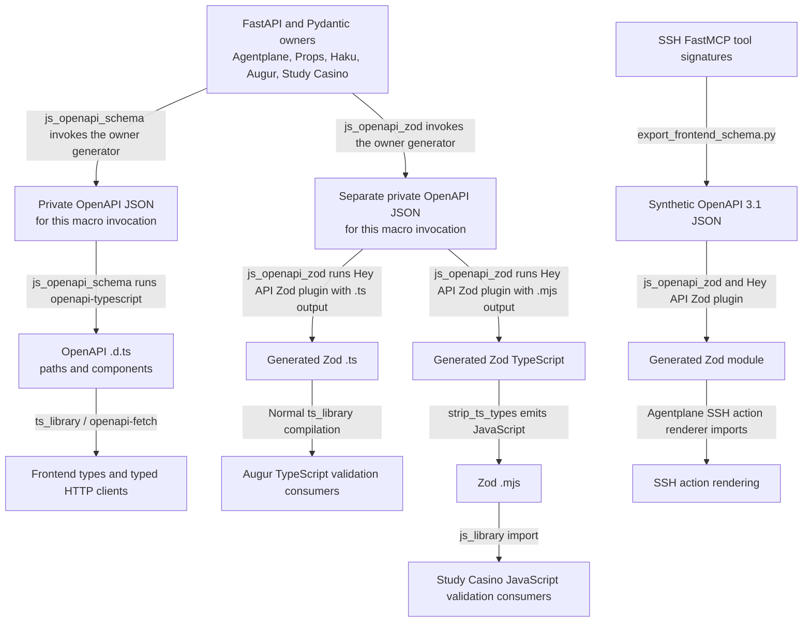

The OpenAPI declaration and Zod branches are distinct macro invocations today; this diagram does
not imply that they share one intermediate artifact.

#### Standalone JSON Schema publication and reverse export

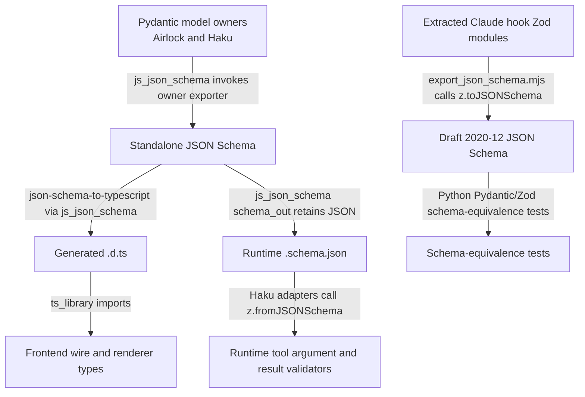

#### JSON Schema to Go and runtime policy validation

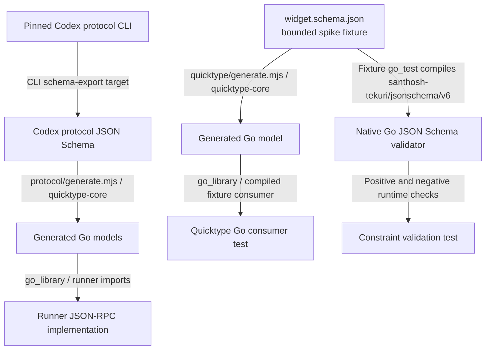

#### Runtime validation of authored policy schemas

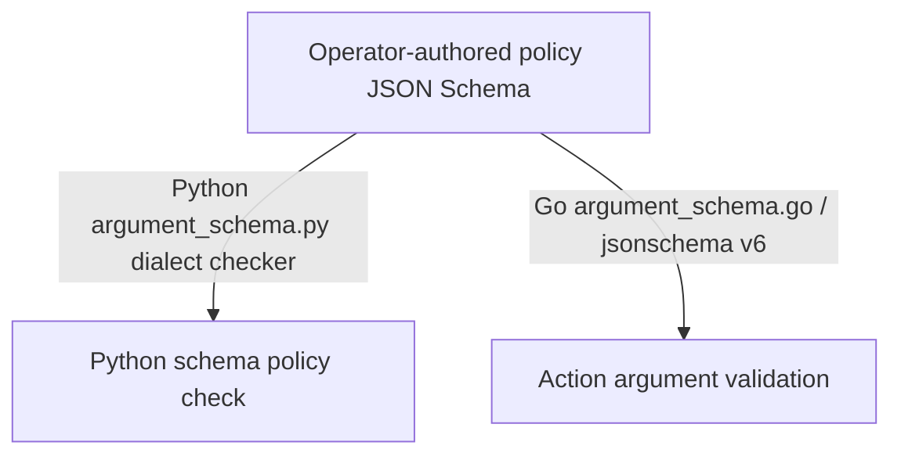

#### Runtime Pydantic tool and provider schemas

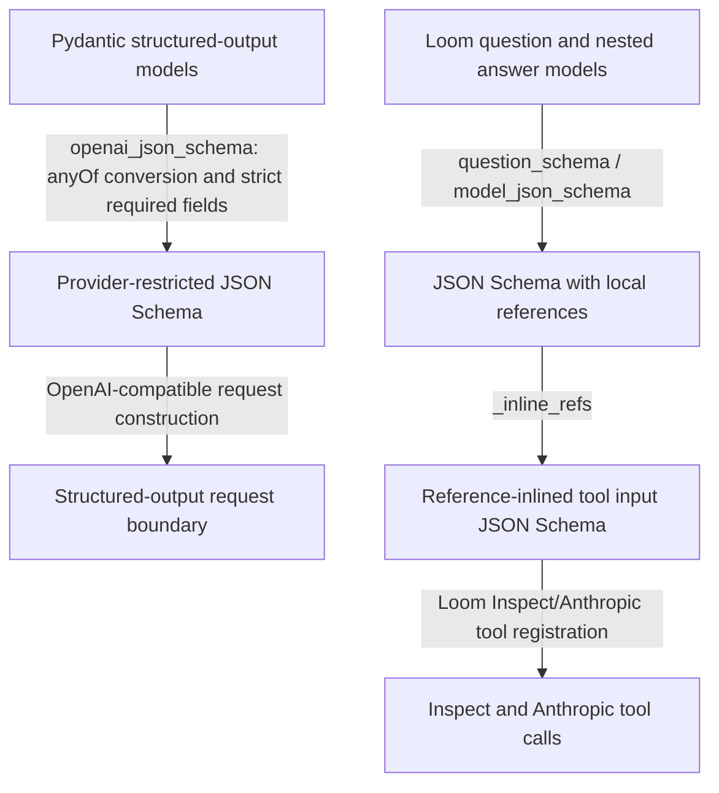

The OpenAI-compatible path covers schema publication only; it does not claim live provider
acceptance. Fixture-specific converter names identify spike code, while the production owners and
rules remain those in the inventory table.

#### Backend vocabulary to TypeScript

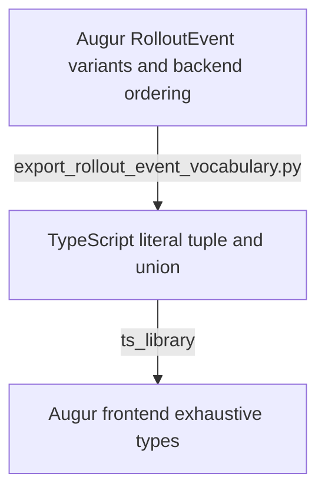

#### Native protobuf message bindings

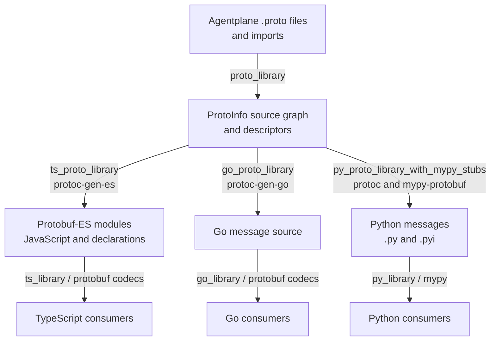

The imported-closure spike uses a local protobuf_es rule invoking protoc-gen-es to emit JS and
declarations directly; its normal TS consumer tests the generated native codecs.

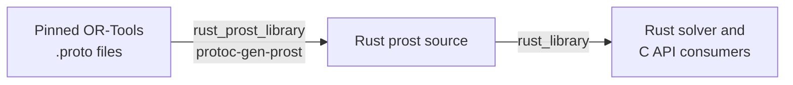

#### Protobuf services and HTTP documentation

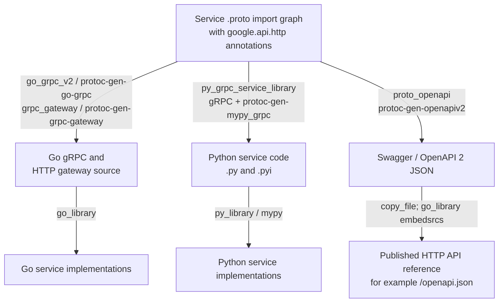

#### Kubernetes artifacts

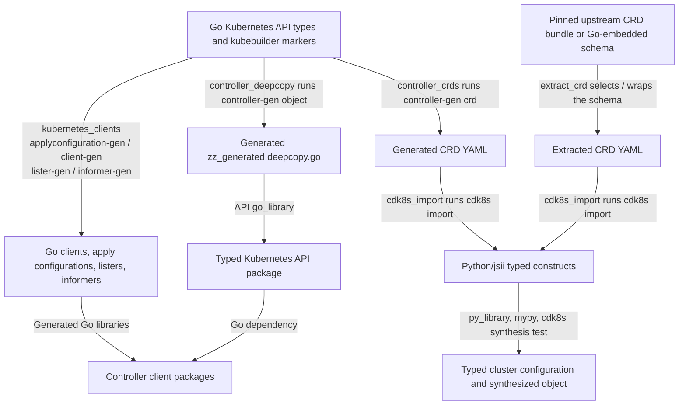

#### Runtime MCP imports

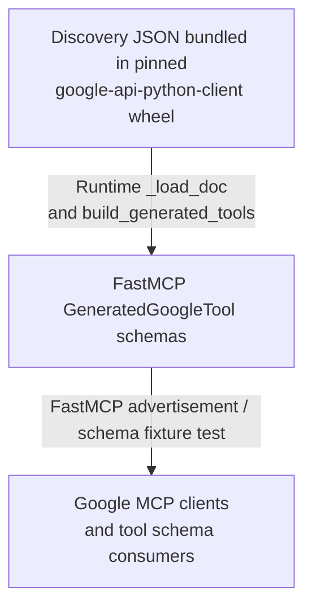

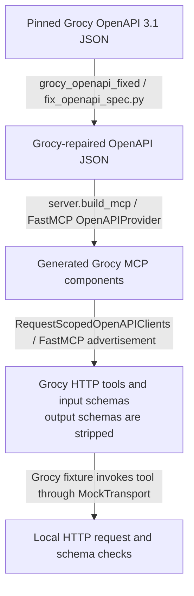

The Discovery and Grocy tests exercise their real runtime adapters with small local documents; they
make no Google network calls. The Grocy fixture checks the owner builder and request-scoped adapter,
but does not exercise the production data-specific OpenAPI repair stage.

The separate runtime-validator work in [PR #12273](https://github.com/agentydragon/ducktape/pull/12273)
adds OpenAPI → Zod consumers in Agentplane, AIQuota, and Spend. The protobuf stack starting at
[PR #12269](https://github.com/agentydragon/ducktape/pull/12269) adds imported-closure generation
and ProtoJSON declaration types for notification/dispatch decoding. These are proposals alongside
this inventory, not prerequisites for running this spike.

## Proposed end state

### Export once, using the owner's real contract

An exporter owns construction of the app, model selection, FastMCP reflection, serialization mode,
and any component-specific vocabulary. Its public Bazel output is an explicit schema file or
schema graph. A Python binary writing JSON to stdout is an execution mechanism, not an input format
for every converter.

Expose separate targets for OpenAPI documents and standalone model/tool JSON Schemas. Generated
files need named Bazel outputs with visibility for their consumers, not `exports_files` declarations
or a global schema registry. Publish schema artifacts only where independent consumers need them;
keep exporter executable dependencies behind the owning target. Name the
direction where relevant: request validation schema versus serialized response schema. Keep
Python/Pydantic and Go API definitions as the sources of truth; the proposal adds no generated
Pydantic-model layer.

OpenAPI declarations and Zod generation should share one `:openapi` artifact. This removes duplicate
export actions and makes the schema available to independent validators and documentation consumers.
Non-HTTP schemas, such as MCP arguments/results, should remain JSON Schema rather than acquire fake
HTTP routes to satisfy a generator.

### Converters consume declared files, not backend executables

The proposed interfaces below describe conversion only. Spike-local helpers demonstrate the
interfaces; production macros remain unchanged until the migration gates below pass. The TS
prototype accepts same-package direct file labels; promotion also needs arbitrary file-target and
cross-package input checks. Its filename handling is not a general Bazel file-label resolver.

#### Proposed file-input routing (design only)

One owner export supplies a declared OpenAPI artifact to both converters. Production macros still
export and convert independently, as shown above. Labels below name proposed interfaces and their
underlying generators; the fixture helpers demonstrate the boundaries without exporting new
production APIs.

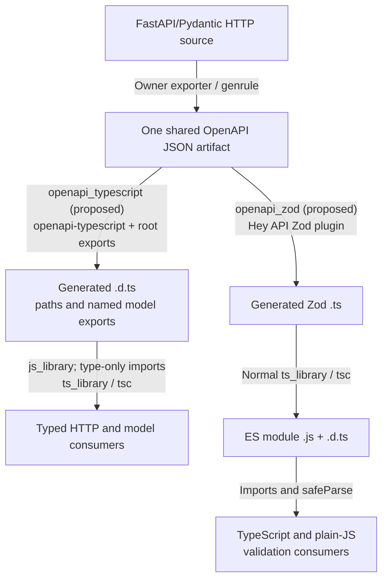

Model and tool schemas use their own file artifact. They enter neither the OpenAPI operation map
nor a synthetic HTTP endpoint.

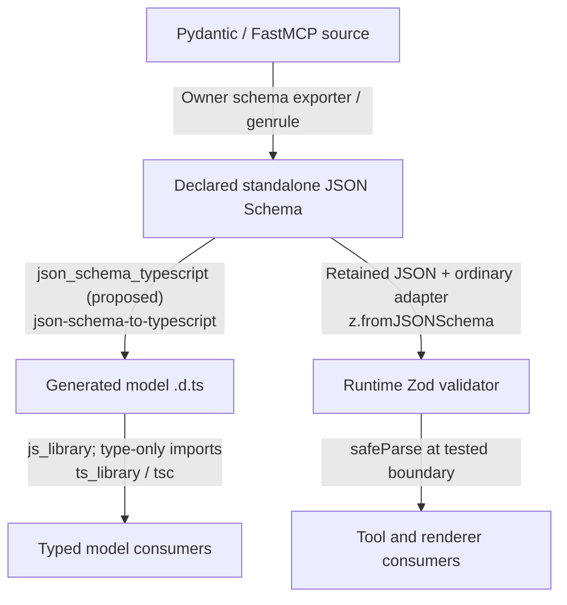

| Conversion                             | Proposed rule or mechanism                                                                         | Output and next stage                                                                                                                      |
| -------------------------------------- | -------------------------------------------------------------------------------------------------- | ------------------------------------------------------------------------------------------------------------------------------------------ |
| OpenAPI 3.0/3.1 → API declarations     | `openapi_typescript(src, out)`, using pinned `openapi-typescript` with named root exports          | `.d.ts` containing direct model exports and `paths`; package in a `js_library` and import into ordinary `ts_library` modules               |
| OpenAPI 3.0/3.1 → Zod implementation   | `openapi_zod(src, out, config)`, using pinned `@hey-api/openapi-ts` Zod 4 plugin                   | `.ts`; compile with ordinary `ts_library` to JS plus declarations; JS-only consumers import the emitted JS                                 |
| JSON Schema → model declarations       | `json_schema_typescript(src, out)`, using pinned `json-schema-to-typescript`                       | `.d.ts`; package independently from the retained source JSON                                                                               |
| JSON Schema → runtime Zod              | Retained JSON plus a normal TS adapter using pinned `z.fromJSONSchema`                             | Runtime validator; generated declarations supply static model types. Keep any assertion joining those two artifacts at one tested boundary |
| Zod → JSON Schema                      | A component-owned JS exporter using `z.toJSONSchema`, invoked with `js_run_binary`                 | Explicitly targeted Draft 2020-12 JSON; choose input/output direction and fail on unrepresentable features                                 |
| Protobuf → language bindings           | `proto_library`/`ProtoInfo` plus language-specific `protoc` rules/plugins                          | Protobuf-ES JS/declarations, Go, Python/stubs, Rust prost; retain native runtime descriptors and codecs                                    |
| Protobuf → RPC service/gateway code    | Existing Go gRPC/gateway compilers and typed Python gRPC macro                                     | Go/Python service code and Go HTTP gateway; normal libraries and consumers                                                                 |
| Protobuf HTTP services → documentation | Existing `proto_openapi`                                                                           | OpenAPI 2 JSON, kept separate from the OpenAPI 3 TS pipeline                                                                               |
| JSON Schema → Go                       | Pinned Quicktype with a component-owned selection/adapter stage                                    | Go source; normal `go_library` and Go tests compile and consume it                                                                         |
| JSON Schema → Go runtime validator     | Existing `santhosh-tekuri/jsonschema/v6` compiler with declared resources and dialect policy       | Runtime validation; generated Go model decoding is not a substitute for schema constraints                                                 |
| Go API types → Kubernetes artifacts    | Existing controller/client generators                                                              | CRD YAML and Go source; publish manifests separately from compilation                                                                      |
| CRD → Python constructs                | Existing `cdk8s_import`                                                                            | Python/jsii package; normal Python type checking and synthesis tests                                                                       |
| OpenAPI → MCP schema/tools             | Existing FastMCP `OpenAPIProvider`, with component-owned repairs and request-scoped client adapter | Runtime tool schemas and HTTP tools; do not route through TS generation                                                                    |
| Discovery JSON → MCP schema            | Existing Google Discovery adapter                                                                  | Runtime tool JSON Schema; validate the actual advertised schema and sample arguments                                                       |
| Pydantic → provider schema             | Existing OpenAI-compatible exporter                                                                | Runtime JSON Schema; provider-subset validation stays with the exporter                                                                    |
| Pydantic → flattened tool schema       | Existing owner-specific adapter, including Loom reference inlining                                 | Runtime JSON Schema; retain the referenced schema for consumers supporting it                                                              |
| Backend vocabulary → TS values/types   | Component-owned exporter                                                                           | `.ts`; ordinary `ts_library` compilation                                                                                                   |

File labels, referenced-schema files, tool configuration, and all generator dependencies must be
declared action inputs. No converter should fetch remote references during a build. JSON Schema
dialect and reference-resolution policy are explicit contracts, not inferred from a `.json` suffix.
A general recursive reference resolver or schema normalization framework is not proposed here.

### Generate named model exports

The operation map remains necessary for typed HTTP calls, but model consumers should be able to
write `import type { InvoiceResponse } from "./api/schema"`. The generator should own the aliases
currently repeated in maintained source as `type InvoiceResponse = components["schemas"]["InvoiceResponse"]`.

The spike exercises the existing `openapi-typescript` root-export options:

```text
--root-types --root-types-no-schema-prefix
```

These request unprefixed model exports while retaining `paths` and `components`. Typed consumers
import generated model names directly; a handwritten forwarding module would leave the same
maintenance burden in a different file. The generator normalizes names, including Pydantic's
`InvoiceLine-Input` and `InvoiceLine-Output` components.

Do not enable `--root-types-keep-casing` globally: the pinned generator emits invalid identifiers
for those hyphenated names. Normalization has its own limit: `HTTPTrace` and `HttpTrace` collide.
Compile generated declarations and their direct imports before migrating each caller. Keep the
indexed component namespace for exceptional collisions until a naming policy is proven; a custom
alias generator is only justified if a required case cannot use the upstream options. The spike
checks supported names and compiler failures rather than claiming arbitrary schemas are safe.

### Language compilation stays in language rules

`tsconfig`, declaration emission, module format, and `isolated_typecheck` belong to `ts_library`.
The OpenAPI converter should not select `ts_library` versus `js_library` by inspecting `out`'s
extension, strip types itself, or accept unrelated backend-export options. Generated Zod is TS
implementation source; its runnable JS and declarations come from normal compilation. The spike
includes a JavaScript-only import so the Study Casino case has a real consumer.

The same distinction applies to Go and Python: code generation produces language artifacts; normal
libraries and tests prove that those artifacts resolve and compile with their real dependencies.
Generated files remain Bazel outputs, except independently published manifests that their owner
already checks into Git.

### Preserve semantics at each boundary

- API operation types and model-only types are distinct outputs. Standalone JSON Schema cannot
  carry an OpenAPI operation's URL, HTTP method, or parameter locations.
- Missing, nullable, and defaulted fields are different. Test both accepted and rejected values;
  do not equate a successful conversion with equivalent defaults or unknown-property behavior.
- Pydantic validation and serialization schemas may differ, including Decimal representation.
  Test serialized producer data against the corresponding generated consumer.
- Datetimes on the wire remain strings, including offsets; timestamp parsing policy is explicit.
- ProtoJSON has its own int64, Timestamp, enum, oneof, and presence semantics. Use protobuf codecs,
  preserve large integers, and handle future numeric enum values explicitly in consuming adapters.
- JSON Schema and Zod describe a structural subset of Python behavior. Custom validators,
  transformations, and arbitrary refinements do not become portable through schema export.
- OpenAPI 2 publication, Kubernetes structural schemas, and provider-restricted JSON Schema retain
  their own adapters. In the protobuf fixture, Swagger lists symbolic enum strings and flattens
  oneof and optional-presence constraints; native ProtoJSON codecs carry the runtime semantics.
  A universal conversion through OpenAPI or JSON Schema is not required.

## Executable proof matrix

The fixtures are deliberately small independent models, not copies of production generated output.
Each generation step runs during Bazel builds; each runtime test consumes the generated artifact.
Static consumers are compiled against generated types. Tests check boundary behavior and important
wire distinctions, rather than generated-source spelling or generator implementation details.

| Case                       | Small source → generated intermediate → consumer                                                                              | Checks                                                                                                                                                                                                               |
| -------------------------- | ----------------------------------------------------------------------------------------------------------------------------- | -------------------------------------------------------------------------------------------------------------------------------------------------------------------------------------------------------------------- |
| API declarations and Zod   | Pydantic/FastAPI fixture → shared OpenAPI JSON → `openapi-typescript` declarations and Hey API Zod TS → typed TS and plain JS | Direct named model imports plus operation-map type checking; Pydantic input/output names and naming limits; runtime valid/invalid response parsing; nested references, discriminated variants, missing/null, offsets |
| Model/tool JSON Schema     | Pydantic fixture → standalone JSON Schema → declarations plus retained JSON → runtime Zod                                     | TS consumer type checking; producer payload acceptance and malformed payload rejection                                                                                                                               |
| Reverse schema publication | Zod source → Draft 2020-12 JSON Schema → Python validator                                                                     | Node export/import succeeds; independent Python validation of accepted and rejected values                                                                                                                           |
| Native protobuf            | Two imported proto files → JS/declarations, Go, Python; common proto → Rust prost → consumers                                 | TS, Go, Python, and Rust checks; producer/consumer JSON interoperability; int64, Timestamp, enum, oneof, optional presence                                                                                           |
| Native services            | Same annotated proto → Go/Python gRPC service bindings and Go gateway → consumers                                             | Typed Python stub construction; Go fake-connection invocation; gateway compile coverage                                                                                                                              |
| Protobuf documentation     | HTTP-annotated proto → Swagger JSON → document consumer                                                                       | Actual operation and schema semantics, independently of generated language bindings                                                                                                                                  |
| Schema → Go                | Tiny protocol JSON Schema → Quicktype Go → typed Go consumer; same schema → native Go JSON Schema validator                   | Go compilation and JSON decoding behavior; reject a schema constraint that model decoding alone accepts                                                                                                              |
| Kubernetes schema/bindings | Tiny annotated Go API → CRD YAML → Python/jsii construct → synthesized object                                                 | Go compilation, CRD content, Python type checking and synthesis; clientset construction, other generated clients compile only                                                                                        |
| OpenAPI tool import        | Small OpenAPI document → real FastMCP provider → advertised tool schemas                                                      | Ref/parameter mapping and valid/invalid tool arguments, with no external service                                                                                                                                     |
| Flattened provider schema  | Nested Pydantic model → real Loom adapter → inline JSON Schema                                                                | Reference-free schema and independent accepted/rejected instance checks; no live provider                                                                                                                            |
| Discovery tool import      | Tiny Discovery document → real adapter → FastMCP advertised JSON Schema                                                       | Independent schema validation and valid/invalid tool argument checks; no Google network call                                                                                                                         |
| Provider schema export     | Tiny Pydantic model → real provider-specific exporter → JSON Schema consumer                                                  | Exported structural contract and representative payload validation; no live provider-acceptance claim                                                                                                                |
| Vocabulary export          | Backend variants/order → TS values and union → typed TS consumer                                                              | Runtime order and static vocabulary contract                                                                                                                                                                         |

The source and target definitions live in [TypeScript](../x/schema_codegen/typescript/BUILD.bazel),
[protobuf](../x/schema_codegen/protobuf/BUILD.bazel), and the infrastructure subpackages
([OpenAPI tools](../x/schema_codegen/infrastructure/grocy_openapi/BUILD.bazel),
[Kubernetes](../x/schema_codegen/infrastructure/kubernetes/BUILD.bazel),
[Quicktype](../x/schema_codegen/infrastructure/quicktype/BUILD.bazel),
[Discovery](../x/schema_codegen/infrastructure/discovery/BUILD.bazel),
[Pydantic](../x/schema_codegen/infrastructure/pydantic/BUILD.bazel)). The reference-inlining check
lives beside its private owning adapter in [Loom](../../loom/gym/test_schema_codegen.py).

```bash
bbr test //devinfra/x/schema_codegen/... //loom/gym:test_schema_codegen --test_output=errors
```

Selecting all labels runs TS compilation, Go and Rust compilation/tests, and Python mypy/ruff
aspects on the selected libraries as well as runtime tests. The shorter
`bbr test //devinfra/x/schema_codegen:tests --test_output=errors` selects the aggregate runtime
suite; it does not independently select every Python library's lint/type aspects.

The combined pre-publication check passed all 20 test targets and built the 140 selected non-test
targets in [BuildBuddy invocation 04ca1220](https://app.buildbuddy.io/invocation/04ca1220-0a50-409d-9260-a5ef424e4081).
This includes TS compilation/ESLint, Python mypy/ruff, Go compilation, and Rust compilation/Clippy
for the selected source libraries. All applicable pre-commit hooks, including Gazelle drift,
passed after rebasing onto `devel`. PR CI remains the check of the published revision.

A successful synthetic fixture proves that conversion path and tool composition; it does
not establish equivalence for every schema in a production corpus. OpenAPI fixtures use 3.1 and
local component references; OpenAPI 3.0 and multi-file external reference graphs are not tested here.
Rust covers the simple common message and enum; the cross-language JSON wire tests cover TS, Go,
and Python. No live RPC server, Kubernetes API, Google service, or LLM provider is needed.

## Migration gates and sequence

1. Review this artifact/interface proposal and the executable cases. Keep conversion helpers under
   `x/` while the required cases or tool behavior remain uncertain.
2. Promote the file-input OpenAPI and JSON Schema converters after the fixture checks pass. Give
   each converter its own format-specific module; continue using existing native protobuf and
   Kubernetes generators.
3. Move one existing OpenAPI caller at a time to an explicit shared export artifact, preserving
   operation types, generated names, timestamp handling, module imports, and runtime behavior.
   Remove the caller's old macro path in the same change. Compare producer fixtures and run the
   owning project's real type, behavior, and browser tests where applicable.
4. Move SSH's non-HTTP schemas to direct JSON Schema consumption only after its actual advertised
   input/output schemas pass the standalone import spike and renderer tests. Retain any
   unsupported case as a named gap; do not weaken it to `unknown` or silently drop a keyword.
5. Reuse the generated JS module for the JavaScript-only consumer and remove schema-specific TS
   stripping once no caller requires it. Delete the superseded executable-input wrappers when
   their last caller has migrated.

The acceptance gate is successful generation, language checks, and boundary behavior for the
production caller being migrated. This PR proposes and demonstrates the architecture; it does not
authorize a repository-wide migration or change any application's wire contract.

Grocy spec repairs, provider-specific reference inlining, and schema restrictions remain with their
owning adapters. Consolidating the older Gmail exporter is a separate caller migration; the spike
uses the shared exporter without claiming identical behavior for every adapter.

## Tool references

Versions come from [`package.json`](../../package.json), [`pnpm-lock.yaml`](../../pnpm-lock.yaml),
and the existing Bazel toolchains. At this revision the JS lockfile resolves OpenAPI TypeScript
7.13.0, Hey API 0.99.0, Zod 4.6.5, json-schema-to-typescript 16.0.0, Quicktype 26.0.0,
Protobuf-ES 2.15.0, and TypeScript 5.9.3. Reuse those pins rather than introducing an alternate tool
installation for the spike.

- [OpenAPI TypeScript](https://openapi-ts.dev/) documents operation/model type generation for
  OpenAPI 3.0 and 3.1.
- [Root-export options](https://openapi-ts.dev/cli#flags)
  expose `rootTypes`, `rootTypesNoSchemaPrefix`, and `rootTypesKeepCasing`; the spike verifies their
  CLI equivalents against the repo's pinned generator.
- [Hey API Zod plugin](https://heyapi.dev/openapi-ts/plugins/zod) documents generated Zod schemas;
  the fixture checks the repo's pinned version and caller-supplied date policy.
- [Zod JSON Schema](https://zod.dev/json-schema) documents both directions. `z.fromJSONSchema` is
  experimental; the proposed adapter is intentionally bounded by tested schema features and pins.
- [`json-schema-to-typescript`](https://github.com/bcherny/json-schema-to-typescript) supplies
  model declarations, not runtime validators.
- [Protobuf-ES](https://github.com/bufbuild/protobuf-es) supplies native message schemas, bindings,
  and codecs. These stay on the protobuf path.
